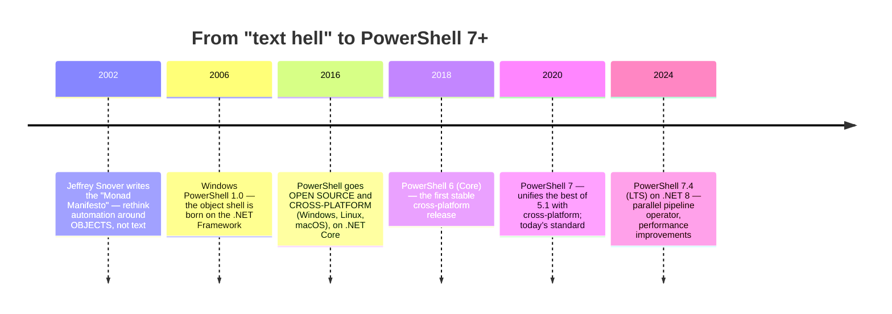

# Module 00 — Introduction and the New Paradigm

**🌍 Language / Idioma:** **English** · [Português](README.md)

> 🌐 *Community translation. Spotted a slip or have a better wording? [Open an issue or PR](https://github.com/dsantos-docencia/power-shell/issues) — see [traducoes/](../../traducoes/README.en.md).*

> *"In Bash, everything is text. In PowerShell, everything is an object. That one sentence changes everything."*

**Suggested load:** 4–6 h · **Level:** absolute zero (even if you've never opened a terminal) · **Prerequisite:** none

## 🎯 By the end of this module you'll be able to

- Explain the fundamental difference between a **text** shell (Bash, CMD) and an **object** shell (PowerShell)
- Tell the story from the Monad project to PowerShell 7+ and why it matters
- Tell **Windows PowerShell 5.1** apart from **PowerShell 7+** and know which to use
- Install and open PowerShell on Windows, Linux, and macOS
- Understand the **ExecutionPolicy** — why it blocks scripts and why it is **not** a security barrier
- Use `Get-Help`, `Get-Command`, and `Update-Help` so you never have to "memorize" again

---

## 1. The big paradigm: object, not text

This is the single most important idea in the whole course. If you leave this module with it, everything else flows.

In **Bash/CMD**, commands talk to each other through **text**. `ls` prints a pile of letters; if you want each file's size, you have to *slice columns* out of that text with `awk`/`cut` — and hope the format doesn't change.

In **PowerShell**, commands talk through **.NET objects**. `Get-ChildItem` doesn't print text: it returns **file objects**, each with properties (`.Name`, `.Length`, `.LastWriteTime`) and methods (`.Delete()`, `.CopyTo()`). You don't slice text — you access properties.

```powershell
# "What are the 3 biggest files in this folder?"
Get-ChildItem | Sort-Object Length -Descending | Select-Object Name, Length -First 3
#              └ file objects             └ sorts by the Length PROPERTY (a real number)
```

Compare it with the Bash equivalent, which depends on *parsing* the output of `ls -l`:
```bash
ls -l | sort -k5 -rn | head -3 | awk '{print $9, $5}'   # fragile: what if a name has a space?
```

| | Text shell (Bash/CMD) | Object shell (PowerShell) |
|---|---|---|
| What flows in the pipe | **text** (bytes, lines) | **objects** (with properties and methods) |
| To grab a field | slice columns (`awk`, `cut`) | access the property (`.Length`) |
| Sort by size | sort text in the 5th column | `Sort-Object Length` (sorts the number) |
| Risk | format changes → script breaks | the object is structured → stable |

> 💡 **The PowerShell "aha!":** you don't have to guess the output format. You **ask the object** what it has — with `Get-Member` (Module 02). The secret isn't memorizing 10,000 commands; it's knowing how to inspect the object a command returned.

> ⚠️ This doesn't mean PowerShell is "better" than Bash — they're tools for different worlds. Bash is unbeatable on Unix with text tools. PowerShell shines where there are structured objects, Windows, Active Directory, APIs. [Module 11](../11-modulos-e-distribuicao/README.en.md) and the [reference](../../referencia/) include a translation guide between the two.

---

## 2. A history in 6 milestones



**The three facts you'll use throughout the course:**

1. **PowerShell was born from an idea, not by accident.** Jeffrey Snover saw that administering Windows through text (as on Unix) was painful because Windows is made of **objects** (COM, WMI, .NET). The Monad Manifesto proposed a shell that passed objects. That's why PowerShell is so different.
2. **There are two "families."** The old one (**Windows PowerShell 5.1**, Windows only) and the modern one (**PowerShell 7+**, cross-platform). Knowing which is which avoids 90% of the confusion (next section).
3. **Today it's cross-platform.** The same PowerShell 7 script can administer a Windows server **and** an Ubuntu box. That's a game-changer for hybrid environments.

---

## 3. Windows PowerShell 5.1 vs. PowerShell 7+

This distinction confuses everyone. Keep the table:

| | **Windows PowerShell 5.1** | **PowerShell 7+** |
|---|---|---|
| Base | .NET Framework (Windows only) | .NET (Core) — cross-platform |
| Where it runs | Windows only | Windows, Linux, macOS |
| How it's called | `powershell.exe` | `pwsh` |
| Pre-installed? | yes, on every Windows | no — installed separately |
| Future | **in maintenance** (no new features) | **the present and the future** |
| Icon color | blue | black/purple |

> 💡 **Rule of thumb:** learn and use **PowerShell 7+** (`pwsh`). It's the modern, cross-platform standard. 5.1 still exists on older Windows servers, and this course flags the differences where they matter (there's a whole set of compatibility notes in [Module 07](../07-erros-e-debugging/README.en.md) and [09](../09-remoting-e-paralelismo/README.en.md)). Commands removed in 7+ (like `Get-WmiObject`, which became `Get-CimInstance`) are covered in [Module 08](../08-dotnet-e-objetos/README.en.md).

---

## 4. Installing and opening

### 🪟 Windows
5.1 is already there. Install 7+ (recommended) one of these ways:
```powershell
winget install Microsoft.PowerShell          # the modern way (Windows 10/11)
```
Or download the MSI from [github.com/PowerShell/PowerShell/releases](https://github.com/PowerShell/PowerShell/releases). Then open **"PowerShell 7"** (the executable is `pwsh.exe`).

### 🐧 Linux (Ubuntu/Debian)
```bash
# via Microsoft's official package (see learn.microsoft.com for your distro)
sudo apt-get update && sudo apt-get install -y powershell
pwsh
```

### 🍎 macOS
```bash
brew install --cask powershell
pwsh
```

### Verifying the installation
Inside PowerShell, the automatic variable `$PSVersionTable` tells you everything:
```powershell
$PSVersionTable
# PSVersion    7.4.x      ← your version
# PSEdition    Core       ← 'Core' = 7+ ; 'Desktop' = 5.1
# Platform     Unix/Win32NT
```

---

## 5. ExecutionPolicy: why scripts get blocked

The first time you try to run a `.ps1` on Windows, you'll probably see:
> *"...cannot be loaded because running scripts is disabled on this system."*

That's the **ExecutionPolicy**. It exists to keep you from running a script **by accident** (a malicious attachment, for example).

```powershell
Get-ExecutionPolicy                              # see the current policy
Set-ExecutionPolicy -Scope CurrentUser RemoteSigned   # allows your local scripts
```

| Policy | What it allows |
|---|---|
| `Restricted` | no scripts (the default on some Windows) |
| `RemoteSigned` | **local** scripts run; **downloaded** ones need a signature — **good choice** |
| `AllSigned` | every script needs a digital signature |
| `Unrestricted` / `Bypass` | runs everything (avoid) |

> ⚠️ **ExecutionPolicy is NOT a security barrier.** It prevents *accidental* execution, but anyone can bypass it (e.g., `pwsh -File script.ps1` or by pasting the content). Real security (code signing, Constrained Language Mode, JEA) is the subject of [Module 10](../10-testes-seguranca-devops/README.en.md). Don't rely on ExecutionPolicy to protect you from an attacker — rely on it to keep you from shooting your own foot.

> 💡 On **Linux/macOS** there's no ExecutionPolicy: you run `pwsh ./script.ps1` or `chmod +x` + the shebang `#!/usr/bin/env pwsh`.

---

## 6. How to ask for help (and stop memorizing)

The PowerShell professional doesn't memorize cmdlets: they **discover** and **inspect**.

| Command | What for |
|---|---|
| `Get-Help <cmdlet>` | synopsis, syntax, parameters |
| `Get-Help <cmdlet> -Examples` | just the examples (start here!) |
| `Get-Help <cmdlet> -Full` / `-Online` | everything / opens the docs in the browser |
| `Get-Command -Verb Get` | **discover** cmdlets by verb |
| `Get-Command -Noun Process` | discover by noun |
| `Get-Member` | **inspect** an object (properties and methods) — the most important |
| `Update-Help` | download the full help (the first thing to do on a new machine) |

```powershell
Update-Help -ErrorAction SilentlyContinue        # downloads the help (once)
Get-Help Get-ChildItem -Examples                 # learn by example
Get-Command -Noun Item                           # all the *-Item (Get/Set/New/Remove...)
Get-Process | Get-Member                          # what does a process object have?
```

> 💡 **The Verb-Noun convention** (next module) lets you *guess* cmdlets: if `Get-Service` exists, then `Start-Service`, `Stop-Service`, `Restart-Service` probably do too. You deduce instead of memorizing.

---

## 🧪 Examples in this module

| File | What it demonstrates |
|---|---|
| [01-objeto-vs-texto.ps1](exemplos/01-objeto-vs-texto.ps1) | The heart of the course: accessing **properties** instead of slicing text |
| [02-raio-x-do-ambiente.ps1](exemplos/02-raio-x-do-ambiente.ps1) | `$PSVersionTable`, edition, platform — the "who am I" |
| [03-pedir-ajuda.ps1](exemplos/03-pedir-ajuda.ps1) | `Get-Command` and `Get-Member`: discover and inspect |

```powershell
pwsh ./modulos/00-introducao-paradigma/exemplos/01-objeto-vs-texto.ps1
```

> 📝 The example scripts are commented in Portuguese for now — the commands, output, and structure are universal. Translating the comments is a great first contribution (see [traducoes/](../../traducoes/README.en.md)).

## ⚠️ Module pitfalls

- Thinking PowerShell is "Bash for Windows" (it's a different paradigm: objects)
- Confusing `powershell.exe` (5.1) with `pwsh` (7+) and being surprised by missing features
- Trusting ExecutionPolicy as if it were real security
- Trying to slice text out of the output instead of using the object's properties

## 🏋️ Exercises

See [exercicios/README.en.md](exercicios/README.en.md). Grade them with:
```powershell
./ferramentas/corrigir.ps1 00
```

## ✅ Mastery checklist

- [ ] I can explain, with an example, the difference between a text shell and an object shell
- [ ] I know the difference between Windows PowerShell 5.1 and PowerShell 7+
- [ ] I installed `pwsh` and can read `$PSVersionTable`
- [ ] I understand what the ExecutionPolicy does — and what it is **not**
- [ ] I use `Get-Command` to discover and `Get-Member` to inspect

---

➡️ [Module 01 — Navigation and Cmdlets](../01-navegacao-cmdlets/README.en.md)

<sub>© 2026 Prof. Daniel Santos and translators · Text under [CC BY-NC-SA 4.0](../../LICENSE-CONTEUDO.md) · Code under [PolyForm NC](../../LICENSE)</sub>
