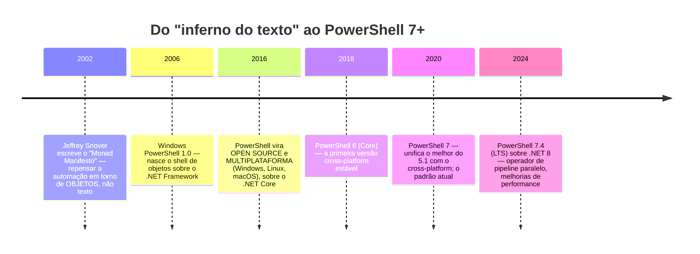

# Módulo 00 — Introdução e o Novo Paradigma

> *"No Bash, tudo é texto. No PowerShell, tudo é objeto. Essa única frase muda tudo."*

**Carga sugerida:** 4–6 h · **Nível:** zero absoluto (mesmo quem nunca abriu um terminal) · **Pré-requisito:** nenhum

## 🎯 Ao final deste módulo você será capaz de

- Explicar a diferença fundamental entre um shell **de texto** (Bash, CMD) e um shell **de objetos** (PowerShell)
- Contar a história do projeto Monad até o PowerShell 7+ e por que ela importa
- Distinguir **Windows PowerShell 5.1** de **PowerShell 7+** e saber qual usar
- Instalar e acessar o PowerShell no Windows, Linux e macOS
- Entender a **ExecutionPolicy** — por que ela bloqueia scripts e por que **não** é uma barreira de segurança
- Usar `Get-Help`, `Get-Command` e `Update-Help` para nunca mais depender de "decorar"

---

## 1. O grande paradigma: objeto, não texto

Esta é a ideia mais importante do curso inteiro. Se você sair deste módulo com ela, o resto flui.

No **Bash/CMD**, comandos conversam por **texto**. O `ls` imprime um monte de letras; se você quer o tamanho de cada arquivo, precisa *recortar colunas* desse texto com `awk`/`cut` — e torcer para o formato não mudar.

No **PowerShell**, comandos conversam por **objetos .NET**. O `Get-ChildItem` não imprime texto: ele devolve **objetos de arquivo**, cada um com propriedades (`.Name`, `.Length`, `.LastWriteTime`) e métodos (`.Delete()`, `.CopyTo()`). Você não recorta texto — você acessa propriedades.

```powershell
# "Quais os 3 maiores arquivos desta pasta?"
Get-ChildItem | Sort-Object Length -Descending | Select-Object Name, Length -First 3
#              └ objetos de arquivo        └ ordena pela PROPRIEDADE Length (um número de verdade)
```

Compare com o equivalente em Bash, que depende de *parsear* a saída do `ls -l`:
```bash
ls -l | sort -k5 -rn | head -3 | awk '{print $9, $5}'   # frágil: e se o nome tiver espaço?
```

| | Shell de texto (Bash/CMD) | Shell de objetos (PowerShell) |
|---|---|---|
| O que passa no pipe | **texto** (bytes, linhas) | **objetos** (com propriedades e métodos) |
| Para pegar um campo | recortar colunas (`awk`, `cut`) | acessar a propriedade (`.Length`) |
| Ordenar por tamanho | ordenar texto da 5ª coluna | `Sort-Object Length` (ordena o número) |
| Risco | formato muda → script quebra | o objeto é estruturado → estável |

> 💡 **O "aha!" do PowerShell:** você não precisa adivinhar o formato da saída. Você **pergunta ao objeto** o que ele tem — com `Get-Member` (Módulo 02). O segredo não é decorar 10.000 comandos; é saber inspecionar o objeto que saiu de um comando.

> ⚠️ Isso não quer dizer que PowerShell é "melhor" que Bash — são ferramentas para mundos diferentes. Bash é imbatível em Unix com ferramentas de texto. PowerShell brilha onde há objetos estruturados, Windows, Active Directory, APIs. O [Módulo 11](../11-modulos-e-distribuicao/) e a [referência](../../referencia/) trazem um guia de tradução entre os dois.

---

## 2. Uma história em 6 marcos



**Os três fatos que você vai usar o curso inteiro:**

1. **PowerShell nasceu de uma ideia, não de um acaso.** Jeffrey Snover viu que administrar Windows por texto (como no Unix) era doloroso porque o Windows é feito de **objetos** (COM, WMI, .NET). O Monad Manifesto propôs um shell que passasse objetos. Por isso o PowerShell é tão diferente.
2. **Existem duas "famílias".** A antiga (**Windows PowerShell 5.1**, só Windows) e a moderna (**PowerShell 7+**, multiplataforma). Saber qual é qual evita 90% da confusão (próxima seção).
3. **Hoje é cross-platform.** O mesmo script PowerShell 7 pode administrar um servidor Windows **e** um Ubuntu. Isso muda o jogo para ambientes híbridos.

---

## 3. Windows PowerShell 5.1 vs. PowerShell 7+

Esta distinção confunde todo mundo. Guarde a tabela:

| | **Windows PowerShell 5.1** | **PowerShell 7+** |
|---|---|---|
| Base | .NET Framework (só Windows) | .NET (Core) — multiplataforma |
| Onde roda | só Windows | Windows, Linux, macOS |
| Como se chama | `powershell.exe` | `pwsh` |
| Vem instalado? | sim, em todo Windows | não — instala-se à parte |
| Futuro | **em manutenção** (sem novos recursos) | **o presente e o futuro** |
| Cor do ícone | azul | preto/roxo |

> 💡 **Regra prática:** aprenda e use **PowerShell 7+** (`pwsh`). Ele é o padrão moderno e multiplataforma. O 5.1 ainda existe em servidores Windows antigos, e este curso aponta as diferenças quando elas importam (há um módulo inteiro — o [07](../07-erros-e-debugging/) e o [09](../09-remoting-e-paralelismo/) — com notas de compatibilidade). Comandos removidos no 7+ (como `Get-WmiObject`, que virou `Get-CimInstance`) são tratados no [Módulo 08](../08-dotnet-e-objetos/).

---

## 4. Instalando e acessando

### 🪟 Windows
O 5.1 já vem. Instale o 7+ (recomendado) por um destes caminhos:
```powershell
winget install Microsoft.PowerShell          # o jeito moderno (Windows 10/11)
```
Ou baixe o MSI em [github.com/PowerShell/PowerShell/releases](https://github.com/PowerShell/PowerShell/releases). Depois, abra o **"PowerShell 7"** (o executável é `pwsh.exe`).

### 🐧 Linux (Ubuntu/Debian)
```bash
# via pacote oficial da Microsoft (veja learn.microsoft.com para sua distro)
sudo apt-get update && sudo apt-get install -y powershell
pwsh
```

### 🍎 macOS
```bash
brew install --cask powershell
pwsh
```

### Verificando a instalação
Dentro do PowerShell, a variável automática `$PSVersionTable` conta tudo:
```powershell
$PSVersionTable
# PSVersion    7.4.x      ← sua versão
# PSEdition    Core       ← 'Core' = 7+ ; 'Desktop' = 5.1
# Platform     Unix/Win32NT
```

---

## 5. ExecutionPolicy: por que scripts são bloqueados

Na primeira vez que você tenta rodar um `.ps1` no Windows, provavelmente verá:
> *"...cannot be loaded because running scripts is disabled on this system."*

Isso é a **ExecutionPolicy**. Ela existe para evitar que você execute um script **por acidente** (um anexo malicioso, por exemplo).

```powershell
Get-ExecutionPolicy                              # ver a política atual
Set-ExecutionPolicy -Scope CurrentUser RemoteSigned   # permite seus scripts locais
```

| Política | O que permite |
|---|---|
| `Restricted` | nenhum script (padrão em alguns Windows) |
| `RemoteSigned` | scripts **locais** rodam; os **baixados** precisam de assinatura — **boa escolha** |
| `AllSigned` | todo script precisa de assinatura digital |
| `Unrestricted` / `Bypass` | roda tudo (evite) |

> ⚠️ **ExecutionPolicy NÃO é uma barreira de segurança.** Ela impede execução *acidental*, mas qualquer um pode contorná-la (ex.: `pwsh -File script.ps1` ou colando o conteúdo). Segurança de verdade (assinatura de código, Constrained Language Mode, JEA) é tema do [Módulo 10](../10-testes-seguranca-devops/). Não confie na ExecutionPolicy para se proteger de um atacante — confie nela para não se dar um tiro no pé.

> 💡 No **Linux/macOS** não há ExecutionPolicy: você roda `pwsh ./script.ps1` ou `chmod +x` + shebang `#!/usr/bin/env pwsh`.

---

## 6. Como pedir ajuda (e parar de decorar)

O profissional de PowerShell não decora cmdlets: ele **descobre** e **inspeciona**.

| Comando | Para quê |
|---|---|
| `Get-Help <cmdlet>` | sinopse, sintaxe, parâmetros |
| `Get-Help <cmdlet> -Examples` | só os exemplos (comece por aqui!) |
| `Get-Help <cmdlet> -Full` / `-Online` | tudo / abre a doc no navegador |
| `Get-Command -Verb Get` | **descobrir** cmdlets por verbo |
| `Get-Command -Noun Process` | descobrir por substantivo |
| `Get-Member` | **inspecionar** um objeto (propriedades e métodos) — o mais importante |
| `Update-Help` | baixar a ajuda completa (a primeira coisa a fazer numa máquina nova) |

```powershell
Update-Help -ErrorAction SilentlyContinue        # baixa a ajuda (uma vez)
Get-Help Get-ChildItem -Examples                 # aprenda pelo exemplo
Get-Command -Noun Item                           # todos os *-Item (Get/Set/New/Remove...)
Get-Process | Get-Member                          # o que um objeto de processo tem?
```

> 💡 **A convenção Verbo-Substantivo** (próximo módulo) faz você *adivinhar* cmdlets: se existe `Get-Service`, provavelmente existe `Start-Service`, `Stop-Service`, `Restart-Service`. Você deduz em vez de decorar.

---

## 🧪 Exemplos deste módulo

| Arquivo | O que demonstra |
|---|---|
| [01-objeto-vs-texto.ps1](exemplos/01-objeto-vs-texto.ps1) | O coração do curso: acessar **propriedades** em vez de recortar texto |
| [02-raio-x-do-ambiente.ps1](exemplos/02-raio-x-do-ambiente.ps1) | `$PSVersionTable`, edição, plataforma — o "quem sou eu" |
| [03-pedir-ajuda.ps1](exemplos/03-pedir-ajuda.ps1) | `Get-Command` e `Get-Member`: descobrir e inspecionar |

```powershell
pwsh ./modulos/00-introducao-paradigma/exemplos/01-objeto-vs-texto.ps1
```

## ⚠️ Armadilhas do módulo

- Achar que PowerShell é "o Bash do Windows" (é um paradigma diferente: objetos)
- Confundir `powershell.exe` (5.1) com `pwsh` (7+) e estranhar recursos que faltam
- Confiar na ExecutionPolicy como se fosse segurança de verdade
- Tentar recortar texto da saída em vez de usar as propriedades do objeto

## 🏋️ Exercícios

Veja [exercicios/README.md](exercicios/README.md). Corrija com:
```powershell
./ferramentas/corrigir.ps1 00
```

## ✅ Checklist de domínio

- [ ] Explico, com um exemplo, a diferença entre shell de texto e de objetos
- [ ] Sei a diferença entre Windows PowerShell 5.1 e PowerShell 7+
- [ ] Instalei o `pwsh` e sei ler o `$PSVersionTable`
- [ ] Entendo o que a ExecutionPolicy faz — e o que ela **não** é
- [ ] Uso `Get-Command` para descobrir e `Get-Member` para inspecionar

---

➡️ [Módulo 01 — Navegação e Cmdlets](../01-navegacao-cmdlets/README.md)

<sub>© 2026 Prof. Daniel Santos · Texto sob [CC BY-NC-SA 4.0](../../LICENSE-CONTEUDO.md) · Código sob [PolyForm NC](../../LICENSE)</sub>
